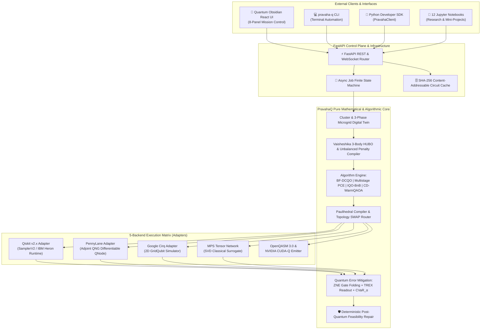
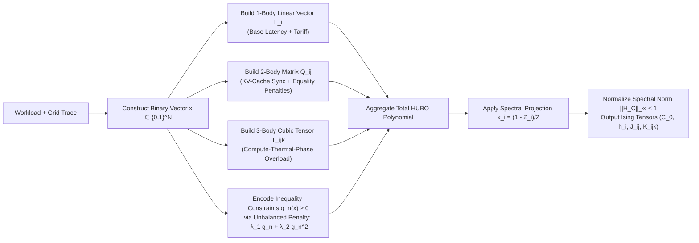
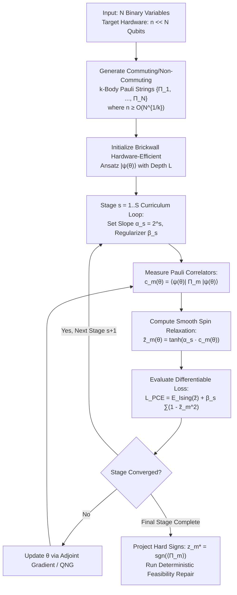
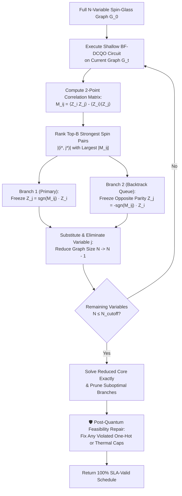

# 🔵 02 — System Architecture & Execution Flowcharts
### **End-to-End C4 Architecture, Compiler Dataflow & Quantum Control Loops**

---

## 1. High-Level Hexagonal Architecture (Ports & Adapters)

PravahaQ enforces strict **Hexagonal Architecture (Clean Architecture)**. The core mathematical domain (`domain/`, `math_engine/`, `algorithms/`) has **zero hard dependencies** on external quantum SDKs or web frameworks. All SDKs (`Qiskit`, `PennyLane`, `Cirq`, `MPS`, `CUDA-Q`) plug in as interchangeable outer adapters.

---

## 2. Flowchart 2: The *Vaisheshika* 3-Body HUBO & Unbalanced Penalty Compiler

---

## 3. Flowchart 3: Multistage Pauli Correlation Encoding (`PCE`) Pipeline

When the number of binary variables $N$ exceeds the available physical qubits $n$ (e.g., $N = 84$ variables on $n = 7$ qubits), PravahaQ automatically routes execution through the **Multistage PCE Pipeline**:

---

## 4. Flowchart 4: Iterative Quantum Branch-and-Bound (`IQO-BnB`) + Feasibility Shield

